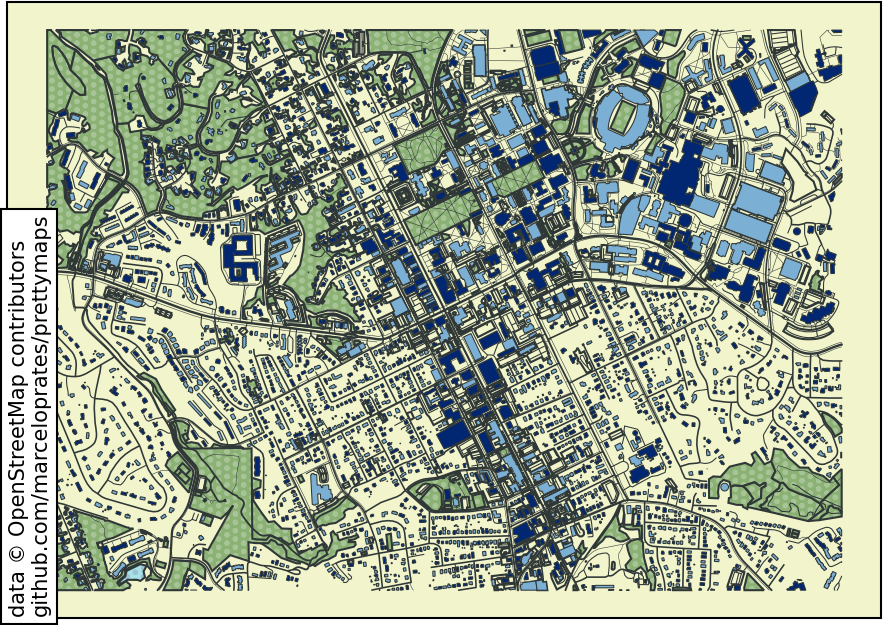
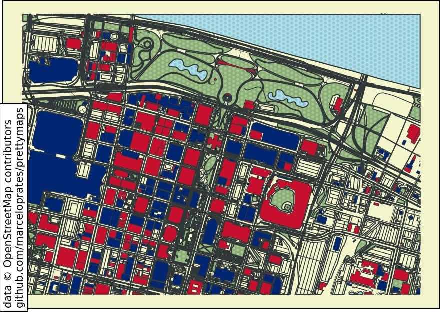
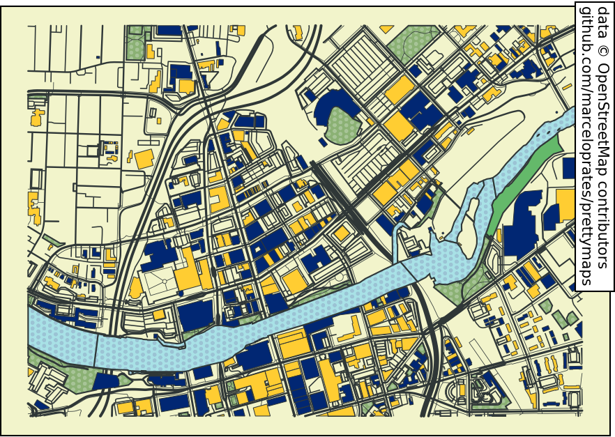

# hi, i'm chloe :)

### 📜 current quest: ai model evaluation & failure analysis
 
<!-- 

  
  
  

-->

 💫 favorite projects so far:

## 🥾 smokies elevation gis
🌿 a gis pipeline that calculates elevation gain per mile for 549 trail sections in the great smoky mountains national park. the sections are sorted by difficulty on an interactive map, built from park trail data and usgs 3dep elevation models

**built with:** python · geopandas · folium
**[explore the map →](https://chloeschm.github.io/smokies_trail_analysis/)**

## 🎮 pagebound
🎨 a top-down roguelike shooter built in flutter and flame. i drew the art, designed the architecture, and shipped it myself on itch.io

**built with:** flutter · flame · dart
**[play on itch.io →](https://chloeschm.itch.io/pagebound)**

  
